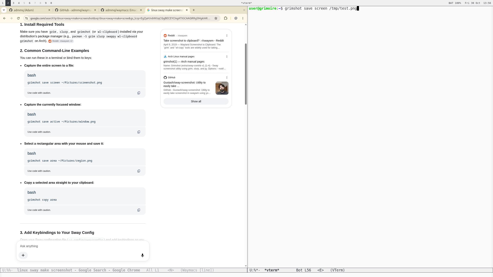

# Message from HUMAN

Hi, Adam here. This project is almost entirely LLM-generated.
Works for me. Anyone, who wants to rewrite is welcome.

# waymacs

Emacs as a Wayland window manager, in the spirit of
[EXWM](https://github.com/emacs-exwm/exwm).

Every application window gets an Emacs buffer.  Showing that buffer in an
Emacs window shows the application there, so `split-window`,
`display-buffer-alist`, `winner-mode`, tab-bar workspaces and the rest of
your Emacs configuration are the window manager.  While an application's
window is selected it gets the keyboard, except for prefix keys such as
`C-x` and `M-x`, which still go to Emacs.

waymacs has two parts:

- `waymacs`, a small Wayland compositor written in C++17 on top of
  [wlroots](https://gitlab.freedesktop.org/wlroots/wlroots).  It shows
  Emacs frames, puts application windows where Emacs says, moves the
  keyboard focus and hands prefix keys to Emacs.  It makes no window
  management decisions of its own.
- `waymacs.el`, which makes all the decisions.

## Dependencies

waymacs was developed and tested on Debian 13 (trixie) with these
packages:

```sh
sudo apt install libwlroots-0.18-dev libwayland-dev wayland-protocols \
    libxkbcommon-dev libpixman-1-dev libinput-dev pkgconf emacs-pgtk xwayland
```

Emacs must be a pgtk build: the session Emacs's frames must be Wayland
windows.  wlroots 0.19 is supported too.

## Building

```sh
make                 # builds ./waymacs
make check           # byte-compiles lisp/waymacs.el, warnings are errors
make test            # end-to-end test without a display (needs foot grim wtype wlrctl)
sudo make install    # /usr/local: waymacs, waymacs-session, the session file
```

`make install` adds a "waymacs" session to display managers.  It does not
install `waymacs.el`: the session uses this checkout's copy.

## Running

```sh
waymacs emacs /path/to/waymacs/lisp     # Emacs and the directory of waymacs.el
waymacs -d emacs /path/to/waymacs/lisp  # with debug logging
test/run-nested.sh                      # try it in a window of your desktop
```

`waymacs EMACS LISPDIR` runs `EMACS -l LISPDIR/waymacs.el -f
waymacs-enable`, and the session ends when Emacs exits.  To start Emacs
differently, give the whole command after `--` (`waymacs -h` lists the
other options):

```sh
waymacs -- emacs -Q -l ~/my-init.el -l /path/to/waymacs/lisp/waymacs.el -f waymacs-enable
```

Loading waymacs on the command line, not in your init file, means only
the session's Emacs loads it: an Emacs you start inside the session reads
the same init file but stays an ordinary application.  Put your settings
in your init file, in `with-eval-after-load`:

```elisp
(with-eval-after-load 'waymacs
  ;; a status bar
  (start-process "waybar" nil "waybar")
  ;; keyboard, monitors, touchpad
  (setq waymacs-xkb-layout "us,ru"
        waymacs-xkb-options "grp:win_space_toggle"
        waymacs-output-settings '((internal :scale 1.5))
        waymacs-pointer-settings '((touchpad :natural-scroll t))))
```

`M-x customize-group RET waymacs` lists all the settings.

## How to debug with gdb

```bash
guix shell -D -f package.scm gdb

make clean debug

gdb --args ./waymacs -d -- emacs -Q -l test/init.el -l lisp/waymacs.el -f waymacs-enable
```
